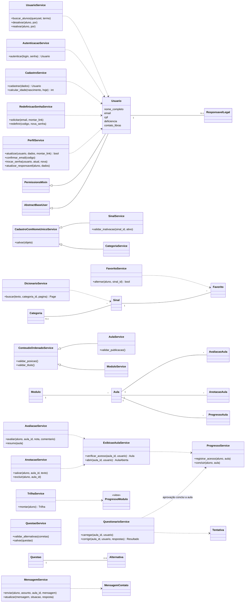
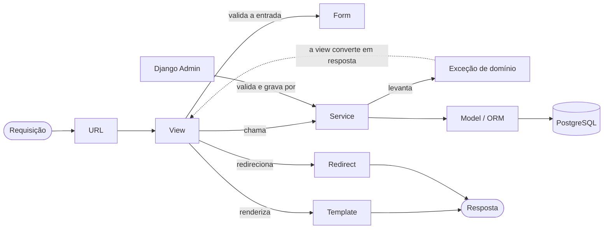

# Arquitetura

O projeto segue MVT, com as regras de negócio concentradas em uma camada de services ([ADR 0001](adr/0001-mvt-com-camada-de-services.md)). O banco é PostgreSQL ([ADR 0002](adr/0002-postgresql-como-banco-de-dados.md)), e a área administrativa é o Django Admin ([ADR 0003](adr/0003-django-admin-como-area-administrativa.md)).

## Apps

O pacote `core` guarda a configuração (`settings.py`, `urls.py`, `wsgi.py`, `asgi.py`) e os validadores de arquivo compartilhados (`core/validadores.py`), que não têm regra de negócio. Cada domínio é um app:

| App | Responsabilidade | Requisitos |
|---|---|---|
| `contas` | Usuário customizado (`AUTH_USER_MODEL`), cadastro, login, logout, bloqueio por tentativas e Admin de usuários | RF001, RF003, RF016 (bônus: RF002, RF004, RF005) |
| `trilha` | Módulos, aulas, materiais complementares, progresso do aluno e tela da vídeo-aula | RF006, RF007, RF013 (bônus: RF018, RF019) |
| `questionarios` | Questões, alternativas, tentativas, correção e histórico do aluno | RF009, RF014 (RF012 já implementado) |
| `dicionario` | Categorias, sinais e busca | RF010, RF015 (bônus: RF017) |
| `contato` | Mensagens do Fale conosco e respostas da equipe (bônus, app novo) | RF020 |

Os campos e as regras definitivos de cada model ficam nas specs. Os models dos bônus RF017 a RF020 são criados antes das telas, para que o DDL entregue tenha as tabelas ([ADR 0009](adr/0009-tabelas-dos-bonus-na-versao-1.md)).

### Modelo de dados

Tabelas da versão 1, com as de todos os bônus: RF017 a RF020 (criadas antes das telas) e RF004, RF005 e RF002. A view `vw_progresso_modulo` é lida pelo model não gerenciado `ProgressoModulo` ([ADR 0006](adr/0006-estruturas-do-banco-em-sql.md)).

```mermaid
erDiagram
    contas_usuario ||--o{ contas_registroauditoria : "autor e alvo"
    contas_usuario ||--o{ trilha_progressoaula : aluno
    contas_usuario ||--o{ questionarios_tentativa : aluno
    contas_usuario ||--o{ dicionario_favorito : aluno
    contas_usuario ||--o{ trilha_anotacaoaula : aluno
    contas_usuario ||--o{ trilha_avaliacaoaula : aluno
    contas_usuario ||--o{ contato_mensagemcontato : aluno
    contas_usuario ||--o{ contas_tokenredefinicaosenha : usuario
    contas_usuario ||--o{ contas_historicoalteracao : usuario
    contas_usuario ||--o{ contas_confirmacaoemail : usuario
    contas_usuario ||--o| contas_responsavellegal : aluno
    dicionario_categoria |o--o{ dicionario_sinal : categoria
    dicionario_sinal ||--o{ dicionario_favorito : sinal
    dicionario_sinal |o--o{ questionarios_questao : "sinal opcional"
    trilha_modulo ||--o{ trilha_aula : modulo
    trilha_aula ||--o{ trilha_materialcomplementar : aula
    trilha_aula ||--o{ trilha_progressoaula : aula
    trilha_aula ||--o{ questionarios_questao : aula
    trilha_aula ||--o{ questionarios_tentativa : aula
    trilha_aula ||--o{ trilha_anotacaoaula : aula
    trilha_aula ||--o{ trilha_avaliacaoaula : aula
    trilha_aula |o--o{ contato_mensagemcontato : "aula opcional"
    questionarios_questao ||--|{ questionarios_alternativa : questao

    contas_usuario {
        bigint id PK
        varchar email UK "minúsculas"
        varchar cpf UK "XXX.XXX.XXX-XX, nulo só para administrador"
        varchar nome_completo
        date data_nascimento
        varchar telefone
        varchar deficiencia "CHECK valores válidos"
        varchar contato_libras "CHECK valores válidos"
        timestamptz termos_aceitos_em
        boolean is_active
        boolean is_staff
    }
    contas_responsavellegal {
        bigint id PK
        bigint aluno_id FK "UK: um por aluno"
        varchar nome
        varchar vinculo "CHECK valores válidos"
        varchar cpf "CHECK formato, não único"
        varchar email
        timestamptz termo_aceito_em
    }
    contas_tokenredefinicaosenha {
        bigint id PK
        bigint usuario_id FK
        varchar codigo_hash UK "SHA-256"
        timestamptz expira_em "CHECK > criado_em"
        timestamptz usado_em
        timestamptz invalidado_em
    }
    contas_solicitacaoredefinicao {
        bigint id PK
        varchar chave "HMAC do e-mail"
        timestamptz criada_em
    }
    contas_historicoalteracao {
        bigint id PK
        bigint usuario_id FK
        varchar campo
        varchar valor_anterior
        varchar valor_novo
        timestamptz alterado_em
    }
    contas_confirmacaoemail {
        bigint id PK
        bigint usuario_id FK
        varchar novo_email
        varchar codigo_hash UK
        timestamptz expira_em "CHECK > criado_em"
        timestamptz confirmado_em
    }
    contas_falhalogin {
        bigint id PK
        varchar chave UK "HMAC do login"
        smallint falhas
        timestamptz bloqueado_ate
    }
    contas_registroauditoria {
        bigint id PK
        bigint autor_id FK
        bigint alvo_id FK
        varchar acao "CHECK valores válidos"
        timestamptz criado_em
    }
    dicionario_categoria {
        bigint id PK
        varchar nome
        varchar nome_normalizado UK
        boolean ativa
    }
    dicionario_sinal {
        bigint id PK
        varchar termo
        varchar termo_normalizado UK "índice GIN pg_trgm"
        varchar classe_gramatical "CHECK valores válidos"
        bigint categoria_id FK
        varchar video
        boolean ativo
    }
    dicionario_favorito {
        bigint id PK
        bigint aluno_id FK
        bigint sinal_id FK
        timestamptz criado_em
    }
    trilha_modulo {
        bigint id PK
        varchar titulo UK "lower(titulo)"
        integer posicao UK "CHECK > 0"
    }
    trilha_aula {
        bigint id PK
        bigint modulo_id FK
        varchar titulo
        integer posicao "UK com modulo"
        varchar video
        varchar legenda
        boolean publicada "CHECK publicada exige vídeo e legenda"
    }
    trilha_materialcomplementar {
        bigint id PK
        bigint aula_id FK
        varchar titulo
        varchar arquivo
    }
    trilha_progressoaula {
        bigint id PK
        bigint aluno_id FK
        bigint aula_id FK
        varchar status "trigger trg_progresso_conclusao"
        timestamptz iniciada_em
        timestamptz concluida_em
    }
    trilha_anotacaoaula {
        bigint id PK
        bigint aluno_id FK
        bigint aula_id FK
        varchar texto "até 2.000, não vazio"
        timestamptz atualizada_em
    }
    trilha_avaliacaoaula {
        bigint id PK
        bigint aluno_id FK
        bigint aula_id FK
        smallint nota "CHECK 1 a 5"
        varchar comentario
        timestamptz avaliada_em
    }
    questionarios_questao {
        bigint id PK
        bigint aula_id FK
        bigint sinal_id FK
        varchar enunciado
        integer posicao "UK com aula"
    }
    questionarios_alternativa {
        bigint id PK
        bigint questao_id FK "índice único parcial WHERE correta"
        varchar texto
        boolean correta
    }
    questionarios_tentativa {
        bigint id PK
        bigint aluno_id FK
        bigint aula_id FK
        smallint acertos "CHECK acertos <= total"
        smallint total "CHECK > 0"
        boolean aprovada
        timestamptz realizada_em
    }
    contato_mensagemcontato {
        bigint id PK
        bigint aluno_id FK
        bigint aula_id FK
        varchar assunto "CHECK valores válidos"
        varchar mensagem "10 a 1.000"
        varchar situacao "CHECK valores válidos"
        varchar resposta
        timestamptz enviada_em
        timestamptz resolvida_em
    }
```



A view `vw_progresso_modulo` calcula, por aluno e módulo, as aulas publicadas, as concluídas e o percentual, a partir de `contas_usuario`, `trilha_modulo`, `trilha_aula` e `trilha_progressoaula`.

### Classes principais

Models e services de cada app. As setas cheias são herança, e as tracejadas são uso. Views, forms e o Admin seguem a seção "Camadas" e chamam esses services.



### Dependências entre apps

- Todos os apps podem usar `core/validadores.py`.
- `dicionario` depende de `contas` só pelo aluno do favorito (`settings.AUTH_USER_MODEL`), e de nenhum outro app.
- `trilha` depende de `contas` (o aluno do progresso, da anotação e da avaliação).
- `questionarios` depende de `trilha` (a aula) e de `dicionario` (o sinal da questão). Na aprovação, chama o service de progresso da `trilha` para concluir a aula ([ADR 0008](adr/0008-pratica-com-camera-adiada.md)).
- `contato` depende de `contas` (o aluno) e de `trilha` (a aula relacionada). Nenhum app importa `contato`.
- `trilha` e `dicionario` não importam `questionarios`. Para exigir ao menos uma questão antes de publicar (RF013) e para barrar a inativação de sinal em uso (RF015), eles consultam pelo nome reverso `questoes`, sem importar classes do outro app. Assim os imports não formam ciclo.
- O questionário tem página própria (`questionarios:responder`). A tela da aula só aponta para ela com ``, sem importar o app.
- Todo model que aponta para o usuário usa `settings.AUTH_USER_MODEL`.

## Camadas



### Organização de cada app

```text
<app>/
├── models/         um módulo por model, reexportados em __init__.py
├── services/       uma classe de service por domínio
├── views/          um módulo por tela
├── forms/
├── templates/<app>/
├── tests/
├── exceptions.py   exceções de domínio do app
├── admin.py
└── urls.py         com app_name
```

### Views (`<app>/views/`)

- Toda view é uma classe que herda diretamente de `django.views.View` e implementa apenas os métodos HTTP necessários (`get`, `post`).
- Mixins de controle de acesso, como `LoginRequiredMixin`, são permitidos. Views baseadas em função e generic views (`ListView`, `CreateView` etc.) não são usadas.
- A view só lê a entrada, chama o service e devolve a resposta (template ou redirect). Não contém regra de negócio nem acessa o ORM, e por isso não usa `get_object_or_404`.
- A view converte exceções de domínio em respostas HTTP, como `Http404` ou uma mensagem no formulário.
- `login()` e `logout()` são chamados na view, pois alteram a sessão HTTP e precisam de `request`. A verificação das credenciais e do bloqueio fica no service.

### Forms (`<app>/forms/`)

- Validam o formato da entrada (tamanho, máscara, CPF, datas) e renderizam os campos.
- Regras que dependem do estado do sistema, como e-mail já cadastrado, ficam no service.
- A gravação é feita pelo service, sem `form.save()`.

### Services (`<app>/services/`)

- São classes, como `CadastroService` ou `ProgressoService`, que agrupam as operações de um domínio.
- Toda regra de negócio fica aqui, incluindo as validações de negócio e as consultas ao ORM.
- Recebem dados simples ou objetos de domínio. Não recebem `request` nem retornam `HttpResponse`.
- Comunicam falhas com exceções de domínio (`<app>/exceptions.py`).
- Usam `transaction.atomic()` quando uma operação faz mais de uma escrita dependente.

### Models (`<app>/models/`)

- Definem campos, relacionamentos, constraints, índices, `Meta` e `__str__`, sem regra de negócio.
- As invariantes de dados ficam também no banco, com `UniqueConstraint` e `CheckConstraint` ([ADR 0002](adr/0002-postgresql-como-banco-de-dados.md)).

### Banco de dados ([ADR 0006](adr/0006-estruturas-do-banco-em-sql.md))

- **O service decide; o banco garante.** A regra e a mensagem ao usuário ficam no service. O banco repete a invariante como última barreira, para que nenhum caminho fora da aplicação a quebre.
- Constraints e índices, inclusive os parciais, são declarados nos models. Só a trigger e a view usam `migrations.RunSQL`, sempre com `reverse_sql`, na migração do app dono da tabela.
- Views do banco são lidas por models com `managed = False`.
- As contas `libras_app` e `libras_relatorio` são criadas por `docs/banco/contas.sql`, executado pelo `postgres`, e não pelas migrações.

### Templates

- Cuidam apenas da apresentação. O layout base fica em `templates/base.html`, e os templates de cada app, em `<app>/templates/<app>/`.

### Admin (`<app>/admin.py`)

- Somente usuários com `is_staff` acessam o Admin. Não existe cadastro público de administrador ([ADR 0003](adr/0003-django-admin-como-area-administrativa.md)).
- O Admin não ignora as regras dos services: `save_model`, `delete_model`, as ações e as validações que dependem de regra chamam os services.

### Arquivos enviados

- Vídeos, legendas, materiais e vídeos de sinais ficam em `MEDIA_ROOT`, com nomes gerados pelo sistema. O tipo real e o tamanho são validados antes de gravar (RS012).
- Em desenvolvimento, o Django serve `MEDIA_URL` quando `DEBUG` está ativo.

### E-mails

- São enviados pelas APIs do Django. Em desenvolvimento, aparecem no terminal ([ADR 0005](adr/0005-emails-no-console-em-desenvolvimento.md)).

## Exemplos

Leitura:

```python
class TrilhaView(View):
    def get(self, request):
        trilha = TrilhaService.montar(aluno=request.user if request.user.is_authenticated else None)
        return render(request, "trilha/trilha.html", {"trilha": trilha})
```

Alteração, com a exceção de domínio convertida em resposta HTTP:

```python
class QuestionarioView(LoginRequiredMixin, View):
    def post(self, request, aula_id):
        form = RespostasForm(request.POST)
        if not form.is_valid():
            return render(request, "questionarios/questionario.html", {"form": form})
        try:
            tentativa = QuestionarioService.corrigir(
                aula_id=aula_id, aluno=request.user, respostas=form.cleaned_data["respostas"]
            )
        except AulaNaoEncontrada as exc:
            raise Http404 from exc
        return redirect("questionarios:resultado", tentativa_id=tentativa.id)
```
