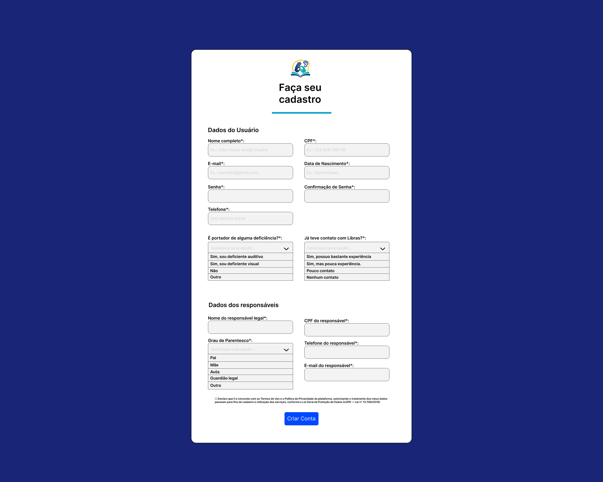
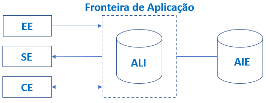
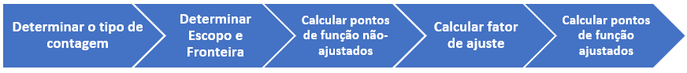
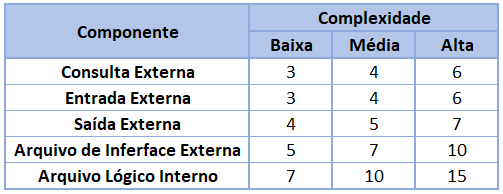

# Documento de Requisitos — Plataforma de Ensino de Libras

> Convertido de `Requisitos_da_Plataforma_de_Ensino_de_Libras_atualizado.docx`. Em caso de divergência, o .docx é a fonte original. Os IDs (RF, RNF, RS) são os mesmos do documento.

## 1. Introdução

Este documento especifica os requisitos do sistema Plataforma de ensino de libras, fornecendo aos desenvolvedores as informações necessárias para o projeto e implementação, assim como para a realização dos testes e homologação do sistema.

### 1.1. Visão geral do documento

Além desta seção introdutória, as seções seguintes estão organizadas como descrito abaixo.

- Seção 2 – Descrição geral do sistema: apresenta uma visão geral do sistema, caracterizando qual é o seu escopo e descrevendo seus usuários.
- Seção 3 – Requisitos funcionais (casos de uso): especifica todos os casos de uso do sistema, descrevendo os fluxos de eventos, prioridades, atores, entradas e saídas de cada caso de uso a ser implementado.
- Seção 4 – Requisitos não-funcionais: especifica todos os requisitos não funcionais do sistema, divididos em requisitos de usabilidade, confiabilidade, desempenho, segurança, distribuição, adequação a padrões e requisitos de hardware e software.
- Seção 5 – Matriz de rastreabilidade: registra a ligação dos requisitos dependentes;
- Seção 6 – Requisitos de Segurança: especifica todos os requisitos de segurança relacionados aos requisitos funcionais e não funcionais;
- Seção 7 – Matriz de Avaliação de Risco: registra os riscos de uma falha de requisito;
- Seção 8 – Referências: apresenta referências para outros documentos utilizados para a confecção deste documento.

### 1.2. Convenções, termos e abreviações

A correta interpretação deste documento exige o conhecimento de algumas convenções e termos específicos, que são descritos a seguir.

#### 1.2.1. Identificação dos requisitos

Por convenção, a referência a requisitos é feita através do nome da subseção onde eles estão descritos, seguidos do identificador do requisito, de acordo com a especificação a seguir:

[nome da subseção. identificador do requisito], por exemplo, o requisito funcional [Recuperação de dados.RF016] deve estar descrito em uma subseção chamada “Recuperação de dados”, em um bloco identificado pelo número [RF016]. Já o requisito não-funcional [Confiabilidade.NF008] deve estar descrito na seção de requisitos não-funcionais de Confiabilidade, em um bloco identificado por [NF008]. [RS001] trata dos requisitos de segurança

Os requisitos devem ser identificados com um identificador único. A numeração inicia com o identificador [RF001], [NF001] ou [RS001] e prossegue sendo incrementada à medida que forem surgindo novos requisitos.

#### 1.2.2. Prioridades dos requisitos

Para estabelecer a prioridade dos requisitos, nas seções 4 e 5, foram adotadas as denominações “essencial”, “importante” e “desejável”.

- Essencial é o requisito sem o qual o sistema não entra em funcionamento. Requisitos essenciais são requisitos imprescindíveis, que têm que ser implementados impreterivelmente.
- Importante é o requisito sem o qual o sistema entra em funcionamento, mas de forma não satisfatória. Requisitos importantes devem ser implementados, mas, se não forem, o sistema poderá ser implantado e usado mesmo assim.
- Desejável é o requisito que não compromete as funcionalidades básicas do sistema, isto é, o sistema pode funcionar de forma satisfatória sem ele. Requisitos desejáveis podem ser deixados para versões posteriores do sistema, caso não haja tempo hábil para implementá-los na versão que está sendo especificada.

## 2. Descrição geral do sistema

### 2.1. Abrangência e sistemas relacionados

A Plataforma de Ensino de Libras é uma aplicação 100% digital desenvolvida para quebrar a barreira de comunicação entre pessoas surdas e ouvintes. O sistema é voltado para o público em geral (crianças, adultos, com ou sem deficiência) e tem o objetivo de ensinar o idioma de forma prática e interativa.

Diferente de plataformas de ensino tradicionais em que o aluno apenas assiste passivamente, este sistema utiliza um Roadmap de ensino baseado em níveis e integra Reconhecimento de Imagem. A plataforma utilizará a câmera do dispositivo do usuário para avaliar se os gestos e sinais reproduzidos pelo aluno estão corretos. Além disso, o sistema conta com recursos de apoio, como um dicionário de vídeos e notificações de lembrete de estudos. O escopo foca exclusivamente em Libras.

## 3. Requisitos funcionais (casos de uso)

### RF001 – Cadastro de usuário

**Objetivo:** Cadastrar novos alunos na plataforma. A conta libera todas as aulas, a prática com câmera (RF008) e o dicionário (RF010). Sem conta, o visitante acessa apenas a landing page e a primeira aula do Módulo 1 (RF006).

**Atores:** Visitante.

**Prioridade:** Essencial.

**Origem:** Ata de Reunião 1, Tópicos 2 e 5.

**Pré-condições:** Nenhuma.

**Cadastro de usuário:**

Nome completo: String, de 3 a 120 caracteres, obrigatório.¹

E-mail: String, até 200 caracteres, obrigatório e único.² ³

CPF: String, 14 caracteres (XXX.XXX.XXX-XX), obrigatório e único.³ ⁴ ⁵

Senha: String, mínimo de 8 caracteres, com letras e números, obrigatório.⁶

Confirmação de senha: String, obrigatório, idêntico ao campo Senha; não é armazenado.

Data de nascimento: Date (DD/MM/AAAA), obrigatória.⁷

Telefone: String, 15 caracteres ((XX) 9XXXX-XXXX), obrigatório.⁸

Possui deficiência: Checkbox (seleção única), obrigatória: Não; Sim, deficiência auditiva; Sim, deficiência visual; Sim, outra; Prefiro não informar.⁹

Qual deficiência: String, até 120 caracteres; exibido e obrigatório apenas quando “Possui deficiência” for “Sim, outra”.¹⁰

Teve contato com Libras: Checkbox (seleção única), obrigatória: Nunca tive contato; Conheço poucos sinais; Conheço o básico; Tenho bastante experiência.¹¹

Aceite dos termos de uso e da política de privacidade: confirmação obrigatória.¹²

**Regras e observações:**

¹ Aceita apenas letras, acentos, espaços, apóstrofo e hífen. Espaços no início, no fim e repetidos são removidos.

² Deve seguir o formato texto@texto.texto e é gravado em letras minúsculas.

³ Não é permitido cadastrar dois usuários com o mesmo CPF ou com o mesmo e-mail; a comparação do e-mail ignora maiúsculas e minúsculas. A duplicidade é verificada ao sair do campo e novamente ao salvar.

⁴ O CPF é validado pelos dígitos verificadores. Pode ser digitado com ou sem pontuação; o sistema aplica a máscara XXX.XXX.XXX-XX automaticamente.

⁵ O CPF não pode ser alterado após o cadastro.

⁶ O campo é mascarado, com opção de exibir o conteúdo. A senha é armazenada somente como hash com salt, nunca em texto puro (RS003).

⁷ Não pode ser futura nem anterior a 120 anos da data atual. A idade é considerada completa na data do aniversário; se for inferior a 18 anos, o cadastro só é concluído com os dados do responsável legal (RF002).

⁸ Deve ser um número de celular. Pode ser digitado com ou sem máscara; o sistema aplica o formato (XX) 9XXXX-XXXX automaticamente.

⁹ É dado pessoal sensível pela LGPD; a opção “Prefiro não informar” permite não declarar (NF006).

¹⁰ Ao trocar a resposta “Sim, outra” por outra opção, o campo é ocultado e seu conteúdo é apagado.

¹¹ A resposta define o módulo recomendado na trilha (RF006): “Nunca tive contato” e “Conheço poucos sinais” → Módulo 1; “Conheço o básico” → Módulo 2; “Tenho bastante experiência” → Módulo 3.

¹² Os termos são exibidos por completo antes do aceite. Sem o aceite, o cadastro não é concluído; a data e a hora do aceite são registradas.

**Mensagens:** “Campo obrigatório não preenchido” (com destaque nos campos);

“Nome inválido”;

“E-mail inválido”;

“E-mail já cadastrado”;

“CPF inválido”;

“CPF já cadastrado”;

“A senha deve ter ao menos 8 caracteres, com letras e números”;

“As senhas informadas não coincidem”;

“Data de nascimento inválida”;

“É necessário aceitar os termos de uso e a política de privacidade”; “Cadastro realizado com sucesso”.

**Alteração e exclusão:** Os dados são alterados pelo próprio aluno conforme o RF005, exceto o CPF e a data de nascimento. O cadastro não é excluído; pode ser desativado pelo administrador (RF016), mantendo-se o histórico.

**PROTÓTIPO:**

### RF002 – Cadastro de Menor de Idade

**Objetivo:** Exigir e registrar os dados do responsável legal quando o aluno tiver menos de 18 anos, bem como a autorização para o cadastro.

**Atores:** Visitante (aluno menor de idade). O responsável legal não acessa o sistema; apenas recebe emails.

**Prioridade:** Essencial.

**Origem:** Decisão da equipe, considerando o público geral definido no Tópico 2 da Ata de Reunião 1 e o tratamento de dados de menores previsto na LGPD.

**Pré-condições:** Idade calculada no RF001 inferior a 18 anos.

**Campos do responsável legal:**

Nome do responsável: String, de 3 a 120 caracteres, obrigatório.¹

Vínculo: Seleção única, obrigatória: Pai; Mãe; Tutor ou guardião legal.

CPF do responsável: String, 14 caracteres (XXX.XXX.XXX-XX), obrigatório.² ³

E-mail do responsável: String, até 200 caracteres, obrigatório.¹ ³

Telefone do responsável: String, 15 caracteres ((XX) 9XXXX-XXXX), obrigatório.¹

Termo de autorização e consentimento (LGPD): confirmação obrigatória.⁴

**Regras de preenchimento dos campos:**

¹ Segue as mesmas regras, máscaras e validações do campo correspondente no RF001.

² É validado pelos dígitos verificadores e deve ser diferente do CPF do aluno.

³ O mesmo responsável pode estar vinculado a mais de um aluno, como irmãos; por isso, o CPF e o e-mail do responsável não são únicos.

⁴ O termo é exibido por completo antes do aceite e confirma que o responsável autorizou o cadastro. Sem o aceite, o cadastro não é concluído; a data e a hora do aceite são registradas.

**Regras de negócio:**

Os campos do responsável só são exibidos, e só são obrigatórios, quando a idade calculada for inferior a 18 anos. Se a data de nascimento for alterada antes de salvar para uma idade de 18 anos ou mais, os campos são ocultados e os dados digitados são descartados.

O cadastro do aluno e o do responsável são gravados juntos (RF001).

Ao concluir o cadastro, o sistema envia ao e-mail do responsável um aviso com o nome do aluno e a data do cadastro (RS006).

Enquanto o aluno for menor, os dados do responsável são alterados pelo próprio aluno na edição de perfil (RF005). Cada alteração é registrada no histórico e gera um e-mail de aviso ao e-mail do responsável anterior à alteração e, se o e-mail tiver mudado, também ao novo.

O sistema verifica diariamente a data de nascimento dos alunos. Quando o aluno completa 18 anos, os dados do responsável deixam de ser obrigatórios, passam a somente leitura como histórico e o responsável deixa de receber e-mails (RF011).

Os e-mails enviados ao responsável não incluem dados sensíveis, como a informação sobre deficiência.

**Mensagens:** “Campo obrigatório não preenchido”; “CPF do responsável inválido”; “O CPF do responsável deve ser diferente do CPF do aluno”; “E-mail inválido”; “É necessário confirmar a autorização do responsável”.

**Alteração e exclusão:** Conforme o RF005, enquanto o aluno for menor de idade, mantendo-se o histórico. Os dados do responsável não são excluídos.

**PROTÓTIPO:**

### RF003 – Login

**Objetivo:** Permitir que usuários cadastrados acessem a plataforma de forma segura e encerrem a sessão. O login libera todas as aulas, a prática com câmera (RF008), o dicionário (RF010) e, para o administrador, a área administrativa (RF013 a RF016).
Atores: Aluno, Administrador.
Prioridade: Essencial.
Origem: Ata de Reunião 1, Tópico 5.
Pré-condições: Usuário cadastrado (RF001) ou administrador criado na implantação (RF013).

Campos:
 Login: String, até 200 caracteres, obrigatório; aceita e-mail ou CPF.¹
 Senha: String, obrigatório.²

Regras de preenchimento dos campos:
¹ Se o valor informado contiver “@”, é tratado como e-mail, sem distinção entre maiúsculas e minúsculas; caso contrário, como CPF, com ou sem pontuação.
² O campo é mascarado, com opção de exibir o conteúdo. A senha informada é comparada com o hash armazenado e nunca é enviada no endereço (URL) nem gravada em registros (logs).

**Regras de negócio:**
 Em caso de credenciais incorretas, a mensagem não informa qual dado está errado nem se o login existe (RS002).
 Após 5 tentativas falhas consecutivas para o mesmo login informado, novas tentativas para esse login ficam bloqueadas por 15 minutos, exista ele ou não (RS001).
 Usuário desativado (RF016) não acessa o sistema. A mensagem “Usuário desativado” só é exibida quando a senha informada está correta.
 Após o login, o aluno é direcionado à plataforma (RF006) e o administrador à área administrativa. Se o usuário tentou abrir uma tela restrita antes de entrar, é levado a ela após o login.
 Qualquer tela restrita acessada sem autenticação, inclusive pelo endereço (URL), redireciona para a tela de login.
 A sessão expira após 30 minutos de inatividade, com aviso ao usuário antes do encerramento (RS010).
 O botão Sair fica disponível em todas as telas autenticadas; encerra a sessão no servidor e direciona à tela de login. O botão Voltar do navegador não reexibe telas autenticadas (RS010).
 A tela de login exibe a opção “Esqueci minha senha” (RF004).

**Mensagens:** “Campo obrigatório não preenchido”; “Login ou senha inválidos”; “Muitas tentativas de acesso. Tente novamente em 15 minutos”; “Usuário desativado”; “Sua sessão expirou. Faça login novamente”.

**Alteração e exclusão:** Não se aplica.

**PROTÓTIPO:**

### RF004 – Recuperação de senha

**Objetivo:** Permitir que o usuário que esqueceu a senha redefina o acesso por meio de um link enviado ao e-mail cadastrado.

**Atores:** Aluno, Administrador.

**Prioridade:** Importante.

**Origem:** Ata de Reunião 1, Tópico 5.

**Pré-condições:** Nenhuma. O link só é enviado se o e-mail pertencer a um usuário cadastrado e ativo (RF001).

**Solicitação de redefinição:**

E-mail: String, até 200 caracteres, obrigatório.¹

**Redefinição de senha:**

Nova senha: String, mínimo de 8 caracteres, com letras e números, obrigatório.²

Confirmação da nova senha: String, obrigatório, idêntico ao campo Nova senha.

**Regras de preenchimento dos campos:**

¹ Se o e-mail pertencer a um usuário ativo, o sistema envia um link de redefinição válido por 30 minutos. A mensagem exibida é a mesma em qualquer caso (RS002).

² Segue as regras de senha do RF001, não pode ser igual à senha atual e é armazenada somente como hash com salt (RS003).

**Regras de negócio:**

O link contém um código aleatório de uso único; deixa de valer após o uso, ao expirar ou quando uma nova solicitação é feita (RS008).

São aceitas no máximo 3 solicitações por hora para o mesmo e-mail.

Ao concluir a redefinição, o sistema encerra todas as sessões ativas do usuário e envia um e-mail informando que a senha foi alterada.

A solicitação e a redefinição são registradas com data e hora.

**Mensagens:** “Se o e-mail estiver cadastrado, você receberá um link para redefinir a senha”;

“Muitas solicitações. Tente novamente mais tarde”;

“Campo obrigatório não preenchido”;

“As senhas informadas não coincidem”;

“A nova senha deve ser diferente da senha atual”;

“Link expirado ou inválido”;

“Senha alterada com sucesso”.

**Alteração e exclusão:** Não se aplica.

**PROTOTIPO: tela Cadastro/Login (seção 9).**

### RF005 – Atualização de Perfil

**Objetivo:** Permitir que o aluno consulte e atualize seus dados, altere a senha e ative ou desative os lembretes de estudo.

**Atores:** Aluno.

**Prioridade:** Importante.

**Origem:** Ata de Reunião 1, Tópico 5; decisão da equipe.

**Pré-condições:** Aluno autenticado (RF003).

**Dados do perfil:**

Nome completo: String, editável.¹

CPF: String, 14 caracteres (XXX.XXX.XXX-XX), somente leitura.

Data de nascimento: Date (DD/MM/AAAA), somente leitura.²

E-mail: String, editável.¹ ³

Telefone: String, editável.¹

Possui deficiência e Qual deficiência: Checkbox e String, editáveis.¹

Teve contato com Libras: Checkbox, editável.¹ ⁴

Foto de perfil: String, endereço do arquivo de imagem JPG ou PNG de até 2 MB, opcional.⁵

Receber lembretes de estudo por e-mail: Boolean (Sim ou Não), padrão Sim.⁶

Dados do responsável legal: editáveis enquanto o aluno for menor de idade.⁷

**Alteração de senha:**

Senha atual: String, obrigatório.⁸

Nova senha e Confirmação: String, obrigatórias.⁹

**Regras de preenchimento dos campos:**

¹ Segue as mesmas opções, regras e validações do campo correspondente no RF001.

² Não pode ser alterada pelo aluno, pois determina a exigência do responsável legal (RF002).

³ Ao alterar o e-mail, o sistema envia um link de confirmação ao novo endereço, válido por 24 horas. Até a confirmação, o e-mail anterior continua valendo para login e envio de e-mails; após a confirmação, o endereço anterior recebe um aviso da alteração (RS011).

⁴ A alteração atualiza o módulo recomendado na trilha (RF006).

⁵ O arquivo é salvo com nome gerado pelo sistema, sem relação com dados pessoais, e substitui a foto anterior; o banco de dados armazena o endereço do arquivo (RS004 e RS012).

⁶ A alteração vale a partir do próximo envio e é a mesma preferência atualizada pelo link de cancelamento dos e-mails (RF011).

⁷ Seguem as regras do RF002. Após o aluno completar 18 anos, são exibidos somente para leitura.

⁸ A troca de senha só é concluída se a senha atual estiver correta.

⁹ Seguem as regras da nova senha do RF004.

**Regras de negócio:**

O aluno só consulta e altera os próprios dados (RS004).

Toda alteração de dados do perfil e do responsável é registrada no histórico, com campo, valor anterior, valor novo, data e hora. A troca de senha é registrada apenas com data e hora, sem os valores. O histórico não pode ser alterado nem excluído (RS007).

Ao clicar em Cancelar, é exibida a mensagem de confirmação do RF001.

**Mensagens:** “Campo obrigatório não preenchido”;

“E-mail inválido”;

“E-mail já cadastrado”;

“Enviamos um link de confirmação para o novo e-mail”;

“Senha atual incorreta”;

“As senhas informadas não coincidem”;

“Arquivo inválido. Envie uma imagem JPG ou PNG de até 2 MB”;

“Dados atualizados com sucesso”.

**Alteração e exclusão:** O perfil não é excluído pelo aluno; pode ser desativado pelo administrador (RF016).

**Protótipo: tela Edição de Perfil (seção 9).**

### RF006 – Trilha de aprendizagem e progresso

**Objetivo:** Apresentar o conteúdo em uma trilha (roadmap) de 3 módulos sequenciais, cada um com suas aulas, mostrar o progresso do aluno e recomendar por qual módulo começar, sem impedir o acesso a nenhum módulo.

**Atores:** Visitante, Aluno.

**Prioridade:** Essencial.

**Origem:** Ata de Reunião 1, Tópico 3.1.

**Pré-condições:** Nenhuma.

**Estrutura da trilha:**

Módulo: título, descrição e posição na trilha.¹

Aula: título, descrição e posição dentro do módulo; pertence a um único módulo.¹

Status da aula, por aluno: String: Não iniciada, Em andamento ou Concluída.²

Progresso, por aluno: Inteiro: percentual de conclusão de cada módulo e do curso, e quantidade de aulas concluídas.³

**Regras de preenchimento dos campos:**

¹ Módulos e aulas são exibidos em ordem de posição, cadastrada conforme o RF013.

² A aula fica Não iniciada até ser aberta pela primeira vez, passa a Em andamento ao ser aberta e a Concluída conforme o RF007. O status é exibido em texto, além de cor e ícone (NF003).

³ Percentual do módulo = aulas concluídas do módulo ÷ aulas publicadas do módulo × 100; percentual do curso = aulas concluídas ÷ aulas publicadas × 100. Os valores são exibidos como inteiros arredondados, em barra de progresso e em texto (por exemplo, “7 de 20 aulas”).

**Regras de negócio:**

O visitante vê a trilha completa, mas só abre a primeira aula publicada do Módulo 1. As demais exibem aviso e direcionam ao login (RF003). O progresso do visitante não é registrado.

Para o aluno autenticado, nenhuma aula é bloqueada.

O módulo recomendado, definido pela resposta “Teve contato com Libras” (RF001), é destacado com a mensagem “Comece pelo Módulo X!”. A recomendação é apenas indicativa.

O botão Continuar leva à aula Em andamento aberta mais recentemente ou, se não houver, à primeira aula não concluída do módulo recomendado.

Somente aulas publicadas (RF013) aparecem na trilha; módulos sem aulas publicadas não são exibidos. Quando uma aula é publicada ou despublicada, os percentuais são recalculados e as conclusões já registradas são preservadas.

O aluno visualiza somente o próprio progresso (RS004).

A trilha é exibida de forma adaptada a celulares e tablets (NF004).

**Mensagens:** “Comece pelo Módulo X!”;

“Faça login para acessar esta aula”.

**Alteração e exclusão:** Não se aplica. O status das aulas é atualizado pelo sistema.

**Protótipo: telas Landing Page e Plataforma (seção 9).**

### RF007 – Vídeo-aula

**Objetivo:** Exibir a aula, composta por vídeo, materiais de apoio, prática com câmera e questionário, e registrar o andamento e a conclusão da aula pelo aluno.

**Atores:** Visitante (apenas a primeira aula do Módulo 1), Aluno.

**Prioridade:** Essencial.

**Origem:** Ata de Reunião 1, Tópico 3.1.

**Pré-condições:** Aula acessível conforme o RF006.

**Conteúdo da aula:**

Vídeo da aula: String, endereço do arquivo de vídeo, obrigatório.¹

Texto de apoio: String, até 2.000 caracteres, opcional.

Materiais complementares: String, endereço de arquivos PDF ou de imagem, opcionais.²

Prática com câmera: um ou mais sinais a reproduzir (RF008).

Questionário: uma ou mais questões (RF009).

**Controles do vídeo:**

Reproduzir, pausar e repetir: botões.³

Velocidade: Seleção única: 0,5x; 1x; 1,5x; padrão 1x.³

Legendas em português: Boolean (ativar ou desativar).⁴

**Regras de preenchimento dos campos:**

¹ Possui legenda em português (NF003). É carregado pausado e a qualidade se ajusta à conexão do aluno. Para o aluno, o ponto de interrupção é salvo e a aula é retomada de onde parou.

² Podem ser visualizados na tela e baixados. Imagens têm texto alternativo. Acessar os materiais não é condição para concluir a aula.

³ Os controles podem ser acionados pelo teclado (NF003).

⁴ As legendas iniciam ativadas para alunos que informaram deficiência auditiva no cadastro (RF001).

**Regras de negócio:**

A aula é concluída quando o aluno conclui a prática com câmera (RF008) e é aprovado no questionário (RF009), em qualquer ordem. O vídeo não precisa ser assistido até o fim para iniciar a prática ou o questionário.

Ao abrir uma aula Não iniciada, o status passa a Em andamento. A data e a hora de início e de conclusão são registradas.

Uma aula concluída permanece concluída; refazer a prática ou o questionário não altera o status.

Na aula liberada ao visitante, é possível assistir ao vídeo, ver os materiais e responder ao questionário, sem registro. A prática com câmera exibe aviso de login.

Ao concluir a aula, o sistema indica a próxima aula da trilha.

Em caso de falha no carregamento do vídeo, o sistema exibe mensagem e um botão para tentar novamente.

**Mensagens:** “Aula concluída!”;

“Faça login para praticar com a câmera e salvar seu progresso”;

“Não foi possível carregar o vídeo. Tente novamente”.

**Alteração e exclusão:** Não se aplica.

**Protótipo: tela Vídeo-aula (seção 9).**

### RF008 – Prática de sinais com câmera

**Objetivo:** Utilizar a câmera do dispositivo e o reconhecimento de gestos para verificar se o aluno reproduz corretamente os sinais da aula.

**Atores:** Aluno.

**Prioridade:** Essencial.

**Origem:** Ata de Reunião 1, Tópico 3.2.

**Pré-condições:** Aluno autenticado (RF003), aula aberta (RF007) e dispositivo com câmera.

**Elementos da prática:**

Sinal a praticar: termo, vídeo de referência e gabarito.¹

Resultado da tentativa: String: Correto ou Incorreto.²

**Regras de preenchimento dos campos:**

¹ Vem do cadastro de sinais (RF015), o mesmo usado no dicionário (RF010). O vídeo de referência é exibido ao lado da imagem do aluno, e os sinais são apresentados na ordem definida na aula (RF013).

² É registrado com data, hora e índice de similaridade.

**Regras de negócio:**

A câmera só é ativada após a permissão do usuário no navegador, somente durante a prática, com indicação visível de que está ativa, e é desligada ao sair da tela (RS005). Funciona com webcam no computador e com a câmera frontal em celulares e tablets.

Antes de avaliar, o sistema verifica se as mãos estão visíveis e se a iluminação é suficiente; se não estiverem, orienta o ajuste, sem contar como tentativa.

A detecção é executada no navegador do aluno, a partir dos pontos de referência das mãos, e comparada com o gabarito do sinal. Nenhuma imagem é enviada ao servidor nem armazenada; o servidor registra apenas o resultado (NF006).

O resultado é Correto quando o índice de similaridade atinge o limite mínimo, que é parametrizável. Pendência: o valor do limite e o conjunto de sinais avaliáveis serão definidos após testes com sinais reais, em versão posterior deste documento.

Sinais com movimento complexo ou que dependam de expressão facial podem ter precisão menor e devem ser validados nos testes.

O resultado é exibido em até 2 segundos (NF005), combinando cor, texto e ícone. O som de sucesso pode ser desligado pelo aluno (NF003).

O número de tentativas é ilimitado, e cada tentativa é registrada (RF012).

A prática da aula é concluída quando todos os sinais da aula forem reconhecidos como corretos ao menos uma vez.

Sem câmera ou com a permissão negada, o sistema informa o motivo e como habilitar a câmera; a prática fica pendente e a aula permanece Em andamento.

**Mensagens:** “Permita o acesso à câmera para praticar”;

“Nenhuma câmera encontrada neste dispositivo”;

“Posicione as mãos dentro da imagem”;

“Melhore a iluminação do ambiente”;

“Sinal correto!”;

“Sinal não reconhecido. Observe o vídeo de referência e tente novamente”.

**Alteração e exclusão:** Não se aplica. O resultado é gerado pelo sistema e não pode ser alterado.

**Protótipo: tela Vídeo-aula (seção 9).**

### RF009 – Questionário

**Objetivo:** Avaliar o aprendizado da aula por meio de questões de múltipla escolha.

**Atores:** Visitante (apenas na primeira aula do Módulo 1), Aluno.

**Prioridade:** Essencial.

**Origem:** Decisão da equipe, complementando o Tópico 3.1 da Ata de Reunião 1.

**Pré-condições:** Aula aberta (RF007).

**Estrutura:**

Questão: enunciado e, opcionalmente, vídeo de um sinal.¹

Alternativas: de 2 a 5 por questão, com exatamente uma correta.¹

**Regras de preenchimento dos campos:**

¹ Questões e alternativas são cadastradas conforme o RF014 e exibidas na ordem definida pelo administrador.

**Regras de negócio:**

Todas as questões devem ser respondidas antes do envio.

O aluno é aprovado ao acertar ao menos 70% das questões.

Após o envio, o sistema exibe o número de acertos, o percentual e a alternativa correta de cada questão errada.

O número de tentativas é ilimitado. Para o aluno, cada tentativa é registrada com acertos, data e hora (RF012); para o visitante, nada é registrado.

**Mensagens:** “Responda todas as questões antes de enviar”;

“Aprovado! Você acertou X de Y questões”;

“Você acertou X de Y questões. É necessário acertar 70% para concluir. Tente novamente”.

**Alteração e exclusão:** Não se aplica.

**Protótipo: tela Questionário (seção 9).**

### RF010 – Dicionário de sinais

**Objetivo:** Permitir que o aluno pesquise palavras e assista ao vídeo do sinal correspondente a qualquer momento, independentemente da trilha.

**Atores:** Aluno.

**Prioridade:** Importante.

**Origem:** Ata de Reunião 1, Tópico 4.

**Pré-condições:** Aluno autenticado (RF003).

**Campos de pesquisa:**

Busca: String, de 2 a 100 caracteres.¹

Categoria: Seleção única, opcional.²

**Dados exibidos de cada sinal:**

Termo: String, palavra em português.³

Vídeo do sinal: String, endereço do arquivo de vídeo, obrigatório.⁴

Classe gramatical, categoria e descrição da execução: quando cadastradas (RF015).

**Regras de preenchimento dos campos:**

¹ Ignora maiúsculas, minúsculas e acentos, retorna os termos que contêm o texto informado e sugere termos enquanto o aluno digita.

² Lista as categorias ativas (RF015), com a opção “Todas” como padrão, e pode ser combinada com a busca.

³ Termos com mais de um sinal são exibidos separadamente, com o sentido entre parênteses, por exemplo “manga (fruta)” e “manga (roupa)”.

⁴ Vídeo curto, sem áudio, reproduzido em loop, que o aluno pode pausar.

**Regras de negócio:**

Somente sinais ativos são exibidos.

Os resultados são exibidos em ordem alfabética, 20 por página.

O dicionário fica acessível pelo menu em qualquer tela autenticada. O visitante que tenta acessá-lo é direcionado ao login.

O cadastro de sinais é o mesmo usado como referência na prática com câmera (RF008).

**Mensagens:** “Digite ao menos 2 caracteres”; “Nenhum sinal encontrado. Revise o termo ou escolha outra categoria”.

**Alteração e exclusão:** Não se aplica.

Protótipo: tela Dicionário (seção 9).

### RF011 – Lembretes e avisos por e-mail

**Objetivo:** Enviar e-mails que lembrem o aluno inativo de continuar os estudos e que informem o responsável legal sobre o aluno menor de idade.

**Atores:** Sistema (envio automático); Aluno e Responsável legal (destinatários).

**Prioridade:** Importante.

**Origem:** Ata de Reunião 1, Tópico 5.

**Pré-condições:** Aluno cadastrado (RF001) e ativo.

**Regras de negócio:**

Uma rotina diária, executada às 9h (horário de Brasília), identifica os alunos que passaram 3 dias sem abrir nenhuma aula e envia o lembrete por e-mail.

Enquanto continuar inativo, o aluno recebe no máximo um lembrete a cada 3 dias; a contagem recomeça quando ele volta a abrir uma aula.

O lembrete contém o nome do aluno, a próxima aula não concluída da trilha (RF006), um link para a plataforma e um link para cancelar o recebimento.

Com os lembretes desativados no perfil (RF005) ou pelo link de cancelamento, o aluno deixa de receber lembretes.

Para aluno menor de idade, o responsável legal (RF002) recebe o mesmo lembrete de inatividade e um aviso sempre que o aluno concluir um módulo, com o nome do aluno, o módulo concluído e o percentual do curso.

Os e-mails ao responsável não incluem dados sensíveis e têm um link próprio para cancelar o recebimento. A preferência do aluno não altera o envio ao responsável, e o envio é interrompido quando o aluno completa 18 anos.

Usuários desativados (RF016) não recebem lembretes nem avisos.

E-mails necessários ao funcionamento da conta, como redefinição de senha (RF004), confirmação de e-mail (RF005) e avisos de cadastro e alteração ao responsável (RF002), não dependem dessas preferências.

Se o envio falhar, o sistema tenta novamente até 3 vezes e segue com os demais envios. Todo envio é registrado com tipo, destinatário, data, hora e situação (enviado ou falha).

Os envios são feitos somente por e-mail. Notificações push estão fora do escopo desta versão.

**Alteração e exclusão:** Não se aplica.

Protótipo: não possui tela própria; a opção de lembretes fica na tela Edição de Perfil (seção 9).

### RF012 – Histórico de desempenho

**Objetivo:** Permitir que o aluno consulte o histórico de suas práticas com câmera e de seus questionários, acompanhando sua evolução.

**Atores:** Aluno.

**Prioridade:** Desejável.

**Origem:** Decisão da equipe.

**Pré-condições:** Aluno autenticado (RF003).

**Filtros:**

Módulo e aula: Seleção única, opcional.

Tipo: Seleção única: Prática com câmera ou Questionário, opcional.

Resultado: Seleção única: Correto, Incorreto, Aprovado ou Reprovado, opcional.

Período: Date (DD/MM/AAAA), data inicial e data final, opcionais.¹

**Dados exibidos de cada tentativa:**

Data e hora, módulo, aula e tipo: da tentativa.

Resultado: Correto ou Incorreto na prática; acertos e Aprovado ou Reprovado no questionário.²

**Regras de preenchimento dos campos:**

¹ A data final não pode ser anterior à data inicial.

² Os dados vêm das tentativas registradas nos RF008 e RF009 e não podem ser alterados nem excluídos.

**Regras de negócio:**

O aluno consulta somente o próprio histórico; o sistema verifica no servidor que os dados pertencem ao usuário autenticado (RS004).

Os registros são exibidos da tentativa mais recente para a mais antiga, 20 por página, e os filtros podem ser combinados.

Para cada aula, o sistema exibe a quantidade total de tentativas e a data da primeira aprovação.

Tentativas de aulas que foram despublicadas depois continuam sendo exibidas.

**Mensagens:** “Nenhuma prática realizada até o momento”;

“A data final não pode ser anterior à data inicial”.

**Alteração e exclusão:** Não se aplica.

**Protótipo: tela Plataforma, área Histórico (seção 9).**

### RF013 – Gestão de módulos e aulas

**Objetivo:** Permitir que o administrador cadastre e mantenha os módulos, as aulas e os materiais complementares da trilha.

**Atores:** Administrador.

**Prioridade:** Essencial.

**Origem:** Decisão da equipe; a Ata de Reunião 1 não define quem mantém o conteúdo.

**Pré-condições:** Administrador autenticado (RF003).

**Cadastro de módulo:**

Título: String, até 100 caracteres, obrigatório.¹

Descrição: String, até 500 caracteres, obrigatório.

Posição: Inteiro, obrigatório.²

**Cadastro de aula:**

Módulo: Seleção única, obrigatória.

Título: String, até 100 caracteres, obrigatório.¹

Descrição: String, até 500 caracteres, obrigatório.

Posição: Inteiro, obrigatório.²

Vídeo: String, endereço do arquivo, obrigatório para publicar.³

Legenda em português: String, endereço do arquivo, obrigatório para publicar.⁴

Texto de apoio: String, até 2.000 caracteres, opcional.

Sinais da prática: Seleção múltipla, um ou mais sinais, obrigatório para publicar.⁵

Situação: Seleção única: Publicada ou Não publicada; padrão Não publicada.⁶

**Cadastro de material complementar:**

Aula: Seleção única, obrigatória.

Título: String, até 100 caracteres, obrigatório.

Arquivo: String, endereço do arquivo PDF ou de imagem, obrigatório.⁷

**Regras de preenchimento dos campos:**

¹ O título do módulo é único na trilha, e o título da aula é único dentro do módulo; a verificação ignora maiúsculas, minúsculas e espaços repetidos.

² Número inteiro positivo, que define a ordem na trilha (RF006). Não pode haver dois módulos com a mesma posição, nem duas aulas com a mesma posição no mesmo módulo.

³ Formato MP4, resolução mínima de 720p, com tronco, mãos e rosto de quem sinaliza bem enquadrados, fundo neutro e boa iluminação.

⁴ Formato SRT ou VTT, em português e sincronizada com o vídeo (NF003).

⁵ Sinais do cadastro do dicionário que possuem gabarito (RF015), na ordem em que serão praticados (RF008).

⁶ Uma aula só pode ser publicada se tiver vídeo, legenda, ao menos um sinal da prática e ao menos uma questão (RF014). Somente aulas publicadas aparecem na trilha (RF006).

⁷ PDF, JPG ou PNG, de até 10 MB.

**Regras de negócio:**

Somente o administrador acessa esta funcionalidade (RS009). Não há cadastro público de administrador: as contas são criadas pela equipe responsável pela implantação, e sempre existe ao menos uma.

Um módulo só pode ser excluído se não possuir aulas. Uma aula só pode ser excluída se não possuir progresso registrado; caso contrário, pode apenas ser despublicada. Materiais complementares podem ser excluídos.

Despublicar uma aula preserva o progresso registrado e recalcula os percentuais da trilha (RF006).

Antes de publicar, o administrador pode visualizar a aula como o aluno a verá.

Os arquivos enviados são validados por tipo e tamanho; arquivos fora do padrão são recusados com mensagem indicando o motivo (RS012).

As listagens exibem 20 registros por página, em ordem de posição, com pesquisa por título e situação.

Ao clicar em Cancelar, é exibida a mensagem de confirmação do RF001.

**Mensagens:** “Campo obrigatório não preenchido”;

“Título já cadastrado”;

“Posição já cadastrada”;

“A aula precisa de vídeo, legenda, sinais e questões para ser publicada”;

“Não é possível excluir um módulo que possui aulas”;

“Esta aula possui progresso registrado e só pode ser despublicada”;

“Arquivo inválido”;

“Cadastro realizado com sucesso”.

**Alteração e exclusão:** Realizadas pelo administrador; toda inclusão, alteração e exclusão é registrada com data e hora.

**Protótipo: tela Área Administrativa (seção 9).**

### RF014 – Gestão de questionários

**Objetivo:** Permitir que o administrador cadastre e mantenha as questões de cada aula.

**Atores:** Administrador.

**Prioridade:** Essencial.

**Origem:** Decisão da equipe, complementando o Tópico 3.1 da Ata de Reunião 1.

**Pré-condições:** Administrador autenticado (RF003) e aula cadastrada (RF013).

**Cadastro de questão:**

Aula: Seleção única, obrigatória.

Enunciado: String, até 500 caracteres, obrigatório.

Vídeo de sinal: Seleção única de um sinal do dicionário (RF015), opcional.

Posição: Inteiro, obrigatório.¹

Alternativas: String, de 2 a 5 alternativas, até 200 caracteres cada, obrigatórias.²

**Regras de preenchimento dos campos:**

¹ Número inteiro positivo, que define a ordem da questão no questionário (RF009); não pode se repetir na mesma aula.

² Cada questão deve ter exatamente uma alternativa marcada como correta.

**Regras de negócio:**

Em aula publicada, a última questão não pode ser excluída; é preciso despublicar a aula antes (RF013).

Alterar ou excluir uma questão não altera as tentativas já registradas (RF012).

A listagem exibe as questões por aula, em ordem de posição.

**Mensagens:** “Campo obrigatório não preenchido”;

“Marque exatamente uma alternativa correta”;

“Posição já cadastrada para esta aula”;

“A aula publicada precisa de ao menos uma questão”;

“Cadastro realizado com sucesso”.

**Alteração e exclusão:** Realizadas pelo administrador; toda inclusão, alteração e exclusão é registrada com data e hora.

**Protótipo: tela Área Administrativa (seção 9).**

### RF015 – Gestão do dicionário

**Objetivo:** Permitir que o administrador cadastre e mantenha as categorias e os sinais usados no dicionário (RF010) e na prática com câmera (RF008).

**Atores:** Administrador.

**Prioridade:** Essencial.

**Origem:** Ata de Reunião 1, Tópicos 3.2 e 4; decisão da equipe.

**Pré-condições:** Administrador autenticado (RF003).

**Cadastro de categoria:**

Nome: String, até 60 caracteres, obrigatório.¹

Situação: Seleção única: Ativa ou Inativa; padrão Ativa.²

**Cadastro de sinal:**

Termo: String, até 100 caracteres, obrigatório.¹ ³

Classe gramatical: Seleção única, opcional: Substantivo; Verbo; Adjetivo; Advérbio; Outros.

Categoria: Seleção única, opcional.

Descrição da execução: String, até 500 caracteres, opcional.

Vídeo do sinal: String, endereço do arquivo de vídeo, obrigatório.⁴

Gabarito do sinal: JSON, opcional.⁵

Situação: Seleção única: Ativo ou Inativo; padrão Ativo.⁶

**Regras de preenchimento dos campos:**

¹ Deve ser único; a verificação ignora maiúsculas, minúsculas e acentos.

² Uma categoria com sinais ativos não pode ser inativada. Categorias inativas não aparecem no filtro do dicionário (RF010).

³ Termos com mais de um sinal são cadastrados com o sentido entre parênteses, por exemplo “manga (fruta)” e “manga (roupa)”.

⁴ Vídeo curto em MP4, adequado à reprodução em loop, com os mesmos padrões de qualidade do vídeo da aula (RF013).

⁵ Gerado pela captura do sinal com a câmera na área administrativa, a partir dos pontos de referência das mãos. É obrigatório para que o sinal possa ser usado na prática de uma aula (RF013).

⁶ Sinal inativo não aparece no dicionário. Um sinal usado em aula publicada não pode ser inativado.

**Regras de negócio:**

Um sinal só pode ser excluído se nunca tiver sido usado em uma aula ou questão; uma categoria só pode ser excluída se não possuir sinais.

Os arquivos enviados são validados por tipo e tamanho (RS012).

A listagem de sinais exibe 20 registros por página, em ordem alfabética, com pesquisa por termo, categoria e situação.

**Mensagens:**

“Campo obrigatório não preenchido”;

“Termo já cadastrado”;

“Categoria já cadastrada”;

“Existem sinais ativos nesta categoria”;

“Este sinal é usado em aulas e não pode ser inativado ou excluído”; “Cadastre o gabarito para usar este sinal na prática”;

“Cadastro realizado com sucesso”.

**Alteração e exclusão:** Realizadas pelo administrador; toda inclusão, alteração e exclusão é registrada com data e hora.

**Protótipo: tela Área Administrativa (seção 9).**

### RF016 – Gestão de usuários

**Objetivo:** Permitir que o administrador consulte os alunos cadastrados e os ative ou desative.

**Atores:** Administrador.

**Prioridade:** Importante.

**Origem:** Decisão da equipe.

**Pré-condições:** Administrador autenticado (RF003).

**Dados exibidos:**

Nome completo, e-mail, data de nascimento e data de cadastro: String (nome e e-mail) e Date (datas), somente leitura.

CPF: String, 14 caracteres, somente leitura, exibido de forma parcial.¹

Dados do responsável legal: somente leitura, para alunos menores de idade.

Situação: Seleção única: Ativo ou Inativo; único campo alterável.²

**Regras de preenchimento dos campos:**

¹ Exibido no formato ***.456.789-**; a pesquisa aceita o CPF completo, com ou sem pontuação (RS004).

² Usuário inativo não acessa o sistema (RF003) e não recebe lembretes nem avisos (RF011). Ao ser reativado, mantém o progresso e o histórico.

**Regras de negócio:**

Ao desativar um usuário, o sistema pede confirmação (“Deseja realmente desativar este usuário?”, com as opções Sim e Não) e encerra imediatamente as sessões ativas dele.

A informação sobre deficiência não é exibida ao administrador (NF006).

Toda consulta ao detalhe de um usuário e toda mudança de situação são registradas com data e hora (RS004).

A pesquisa aceita CPF, parte do nome, e-mail e situação, combinados. A listagem exibe 20 registros por página, em ordem alfabética do nome.

**Mensagens:** “Deseja realmente desativar este usuário?”;

“Usuário desativado com sucesso”;

“Usuário reativado com sucesso”;

“Nenhum usuário encontrado”.

**Alteração e exclusão:** Restrita ao campo Situação. Usuários não são excluídos.

Protótipo: tela Área Administrativa (seção 9).

## 4. Requisito não Funcional

| ID | Requisito | Descrição | Prioridade |
|---|---|---|---|
| [RNF01] | Usabilidade, facilidade de uso | A interface deve ser intuitiva, com dicas (hint) nos botões, ajuda nas telas de prática e de questionário e acesso ao dicionário pelo menu. Qualquer tela principal deve ser alcançada em no máximo 3 cliques a partir da plataforma. | Importante |
| [RNF02] | Usabilidade, mensagens | Toda ação que não puder ser realizada deve exibir mensagem específica junto ao campo ou à ação, sem apagar os dados já preenchidos. | Importante |
| [RNF03] | Acessibilidade | Todo conteúdo deve ser compreensível sem áudio: os vídeos têm legenda em português e nenhuma informação é transmitida apenas por som ou apenas por cor. A interface segue as WCAG 2.1, nível AA, incluindo contraste, navegação e controle do vídeo pelo teclado e texto alternativo em imagens. | Essencial |
| [RNF04] | Distribuição, compatibilidade | O sistema é uma aplicação web, sem instalação, compatível com as duas versões mais recentes do Chrome, Firefox, Edge e Safari, em computador e celular, com layout responsivo a partir de 360 px de largura. | Essencial |
| [RNF05] | Desempenho | As páginas devem carregar em até 3 segundos em conexão de 10 Mbps. O resultado da prática com câmera (RF008) deve ser exibido em até 2 segundos após o aluno concluir o sinal. | Importante |
| [RNF06] | Privacidade, adequação à LGPD | O sistema coleta apenas os dados previstos nos requisitos funcionais, permite não informar a deficiência, registra data e hora dos consentimentos (RF001 e RF002), não exibe a deficiência ao administrador (RF016) nem a envia por e-mail (RF011), e não grava nem armazena imagens da câmera (RF008). | Essencial |
| [RNF07] | Confiabilidade | O banco de dados deve ter cópia de segurança diária, mantida por 7 dias. | Importante |
| [RNF08] | Hardware e software, usuário | Dispositivo com navegador compatível (NF004) e conexão à internet. Para a prática com câmera (RF008), o dispositivo precisa de câmera. | Essencial |
| [RNF09] | Hardware e software, servidor | Servidor capaz de executar a aplicação web e o banco de dados PostgreSQL, com espaço de armazenamento para os vídeos e arquivos das aulas e do dicionário, serviço de envio de e-mail (RF002, RF004, RF005 e RF011) e agendamento da rotina diária (RF002 e RF011). | Essencial |

## 5. Requisito de Segurança

| ID | Perigo | Soluções |
|---|---|---|
| [RS001] | Perigo: ataque de força bruta no login (RF003) para descobrir senhas. | Bloquear por 15 minutos as tentativas para um login após 5 falhas consecutivas e exibir mensagem genérica de erro. |
| [RS002] | Perigo: enumeração de contas, quando as mensagens do login (RF003) ou da recuperação de senha (RF004) revelam se um e-mail ou CPF está cadastrado. | Exibir a mesma mensagem esteja o login ou o e-mail cadastrado ou não, e exibir “Usuário desativado” somente com a senha correta. |
| [RS003] | Perigo: vazamento de senhas armazenadas (RF001, RF004 e RF005). | Armazenar senhas somente como hash com salt, nunca em texto puro, e não registrar senhas em logs nem no histórico de alterações. |
| [RS004] | Perigo: exposição de dados pessoais e sensíveis, como CPF, deficiência e dados de menores e responsáveis (RF001, RF002, RF005, RF012 e RF016). | Permitir a cada aluno acessar apenas os próprios dados, verificando no servidor; usar HTTPS em todas as páginas; exibir o CPF de forma parcial ao administrador; registrar as consultas do administrador; nomear a foto de perfil sem dados pessoais; e separar as permissões do banco de dados por perfil de acesso. |
| [RS005] | Perigo: captura ou armazenamento indevido de imagens da câmera (RF008). | Ativar a câmera somente com permissão do usuário e durante a prática, indicar quando está ativa, processar as imagens no navegador e não gravar, enviar nem armazenar imagens. |
| [RS006] | Perigo: cadastro de menor de idade sem o conhecimento do responsável (RF002). | Exigir o termo de autorização e enviar e-mail de aviso ao responsável no cadastro e a cada alteração dos seus dados. |
| [RS007] | Perigo: alteração de dados do perfil ou do responsável sem rastreio (RF002 e RF005). | Registrar toda alteração em histórico que não pode ser alterado nem excluído e exigir a senha atual para trocar a senha. |
| [RS008] | Perigo: reutilização ou interceptação do link de redefinição de senha (RF004). | Usar código aleatório de uso único, válido por 30 minutos e invalidado por nova solicitação, e limitar a 3 solicitações por hora. |
| [RS009] | Perigo: acesso indevido à área administrativa (RF013 a RF016). | Restringir a área administrativa ao perfil de administrador, sem cadastro público dessas contas, verificar o perfil no servidor a cada requisição e registrar login e logout do administrador com data e hora. |
| [RS010] | Perigo: uso indevido de sessão aberta em dispositivo compartilhado (RF003). | Expirar a sessão após 30 minutos de inatividade, encerrar a sessão no servidor ao sair e impedir que o botão Voltar reexiba telas autenticadas. |
| [RS011] | Perigo: tomada de conta pela alteração do e-mail cadastrado (RF005). | Exigir confirmação pelo novo endereço antes de efetivar a troca e avisar o endereço anterior após a alteração. |
| [RS012] | Perigo: envio de arquivos maliciosos ou fora do padrão (RF005, RF013 e RF015). | Validar o tipo real e o tamanho dos arquivos, salvá-los com nomes gerados pelo sistema e nunca executá-los no servidor. |

## 6. Matriz de Avaliação de Risco

| Segurança/ probabilidade | Catastrófico (1) | Crítico (2) | Marginal (3) | Insignificante (4) |
|---|---|---|---|---|
| Frequente (A) |  |  |  |  |
| Provável (B) |  |  |  |  |
| Ocasional (C) | RS004, RS006 | RS001 | RS010 |  |
| Remoto (D) | RS003 | RS008, RS009, RS011, RS012 | RS007 | RS005 |
| Improvável (E) | RS002 |  |  |  |
| Eliminado (F) |  |  |  |  |

## 7. Matriz de Rastreabilidade – Requisito Funcional

| ID de requisitos | RF001 | RF002 | RF003 | RF004 | RF005 | RF006 | RF007 | RF008 | RF009 | RF010 | RF011 | RF012 | RF013 | RF014 | RF015 | RF016 |
|---|---|---|---|---|---|---|---|---|---|---|---|---|---|---|---|---|
| RF001 |  | D |  |  |  |  |  |  |  |  |  |  |  |  |  |  |
| RF002 | D |  |  |  |  |  |  |  |  |  |  |  |  |  |  | R |
| RF003 | D |  |  | R |  | R | R |  |  |  |  |  |  |  |  | D |
| RF004 | D |  | R |  | R |  |  |  |  |  |  |  |  |  |  | R |
| RF005 | D | D | D | R |  | R |  |  |  |  |  |  |  |  |  | R |
| RF006 | D |  | R |  | R |  | D |  |  |  |  |  | D |  |  |  |
| RF007 | D |  | R |  |  | D |  | D | D |  |  |  | D |  |  |  |
| RF008 |  |  | D |  |  |  | D |  |  | R |  |  | D |  | D |  |
| RF009 |  |  |  |  |  |  | D |  |  | R |  |  |  | D |  |  |
| RF010 |  |  | D |  |  |  |  | R | R |  |  |  | R |  | D |  |
| RF011 | D | D |  |  | D | D | D |  |  |  |  |  |  |  |  | D |
| RF012 |  |  | D |  |  |  |  | D | D |  |  |  | R | R |  |  |
| RF013 |  |  | D |  |  |  |  |  |  | R |  | R |  | D | D |  |
| RF014 |  |  | D |  |  |  |  |  |  |  |  | R | D |  | D |  |
| RF015 |  |  | D |  |  |  |  |  |  |  |  |  |  |  |  |  |
| RF016 | D | R | D | R | R |  |  |  |  |  |  |  |  |  |  |  |

## 8. Ponto de função

Para que seja conhecido o tamanho funcional de um software, são realizadas medições da quantidade de funcionalidades que um software possui, ou seja, quantas funcionalidades ele é capaz de fornecer ao seu usuário.

Desse modo, a Análise por Pontos de Função é um método que divide o aplicativo de software em partes menores, sendo realizada a contagem de funcionalidades em cada uma dessas partes, de modo a constatar qual o tamanho total do software analisado.

**4.1 Componentes Fundamentais**

Funções do tipo Dado: são aqueles relacionados ao armazenamento de dados, sendo o Arquivo Lógico Interno e o Arquivo Lógico Externo;

Funções do tipo Transação: são aquelas realizadas a atividades de processamento realizadas pelo usuário, englobando a Entrada Externa, Saída Externa e a Consulta Externa.

**Arquivo Lógico Interno (ALI)**

O arquivo lógico interno corresponde a um grupo de dados de controle relacionados logicamente, reconhecidos pelos usuários, os quais são armazenados dentro da fronteira de aplicação. Em outras palavras, trata-se de dados mantidos em tabelas em um banco de dados.

**Arquivo de Interface Externa (AIE)**

O arquivo de interface externa é similar ao ALI, sendo também um grupo de dados de controle logicamente relacionados, porém, eles são armazenados do lado externo/fora da fronteira de aplicação, sendo ele mantido por outra aplicação. Desse modo, um arquivo de interface externa de uma aplicação sempre será um arquivo lógico interno de outra aplicação.

**Entrada Externa (EE)**

Uma entrada externa corresponde ao processamento de dados originados do lado de fora da fronteira de aplicação, ou seja, recebidos externamente. Essas entradas externas podem provocar ou não alterações no comportamento do sistema, através de exclusões, inclusões ou alterações em dados armazenados no ALI.

**Saída Externa (SE)**

A saída externa, por sua vez, é realizada quando há o envio de dados de dentro da fronteira de aplicação para o ambiente externo, sendo que ela sempre irá alterar o comportamento do sistema. Em outras palavras, a saída externa exibe ao usuário informações que são obtidas por meio de um processamento lógico de dados, através de cálculos e operações dos dados, não sendo apenas uma mera consulta.

**Consulta Externa (SE)**

Ela é similar à saída externa, porém, não há alteração do comportamento do sistema, não há nenhum cálculo ou alteração dos dados, sendo apenas realizada mera consulta/recuperação dos dados dentro da fronteira de aplicação.

**Determinar o tipo de contagem**

Para esse projeto X, utilizaremos a contagem para projeto em desenvolvimento, que mede a funcionalidade fornecida aos usuários finais do software quando da primeira instalação entregue quando o projeto estiver pronto;

**Determinar Escopo e Fronteira**

Escolhido o tipo de contagem a ser utilizado, é necessário agora definir qual será o escopo: O sistema realizará a contagem dos requisitos funcionais de todos os módulos que compõem o sistema X, vale salientar que o sistema está limitado aos módulos internos e não integrações com sistemas externos.

**Calcular pontos de função não-ajustados**

A definição do tamanho funcional de um software, através da medição de cada um dos cinco componentes já informados anteriormente (ALI, AIE, EE, SE e CE).

Será utilizada a tabela abaixo para calculo dos pontos de função do sistema X.

Os valores acima serão utilizados para calcular o número de pontos de função não-ajustados. Multiplicando a quantidade dos componentes pelo valor da complexidade.

**PONTO DE FUNÇÃO – SISTEMA GESTÃO**

| REQUISITO FUNCIONAL | COMPLEXIDADE | ALI | AIE | SE | EE | CE | TOTAL |
|---|---|---|---|---|---|---|---|
| RF001 | BAIXA | 7 | 0 | 0 | 4 | 0 | 11 |
| RF002 | MÉDIA | 7 | 0 | 4 | 7 | 0 | 18 |
| RF003 | BAIXA | 7 | 0 | 0 | 3 | 0 | 10 |
| RF004 | BAIXA | 0 | 0 | 4 | 6 | 0 | 10 |
| RF005 | MÉDIA | 7 | 0 | 4 | 12 | 4 | 27 |
| RF006 | BAIXA | 0 | 0 | 7 | 0 | 0 | 7 |
| RF007 | MÉDIA | 7 | 0 | 0 | 6 | 4 | 17 |
| RF008 | MÉDIA | 7 | 0 | 5 | 4 | 3 | 19 |
| RF009 | BAIXA | 7 | 0 | 5 | 0 | 3 | 15 |
| RF010 | BAIXA | 0 | 0 | 0 | 0 | 7 | 7 |
| RF011 | MÉDIA | 7 | 0 | 14 | 3 | 0 | 24 |
| RF012 | BAIXA | 0 | 0 | 5 | 0 | 0 | 5 |
| RF013 | ALTA | 14 | 0 | 0 | 37 | 11 | 62 |
| RF014 | MÉDIA | 7 | 0 | 0 | 16 | 4 | 27 |
| RF015 | ALTA | 14 | 0 | 0 | 30 | 7 | 51 |
| RF016 | MÉDIA | 7 | 0 | 5 | 4 | 4 | 20 |

## 9. Referências

- Baseado no documento de requisitos disponível em <https://www.google.com/url?sa=t&rct=j&q=&esrc=s&source=web&cd=3&sqi=2&ved=0CCwQFjAC&url=http%3A%2F%2Fdemo.chiliproject.org%2Fattachments%2F169%2FdocumentoRequisitos.doc&ei=kPnfU-WKIs6XyATC5IC4Bw&usg=AFQjCNESjuE4x3e3nXsTuY3tnt4aqobn1A&bvm=bv.72197243,d.b2U&cad=rja>
